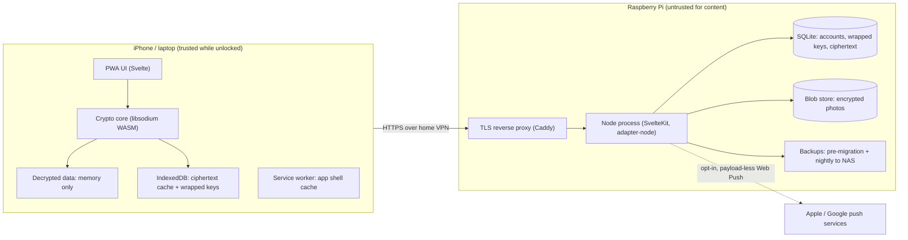
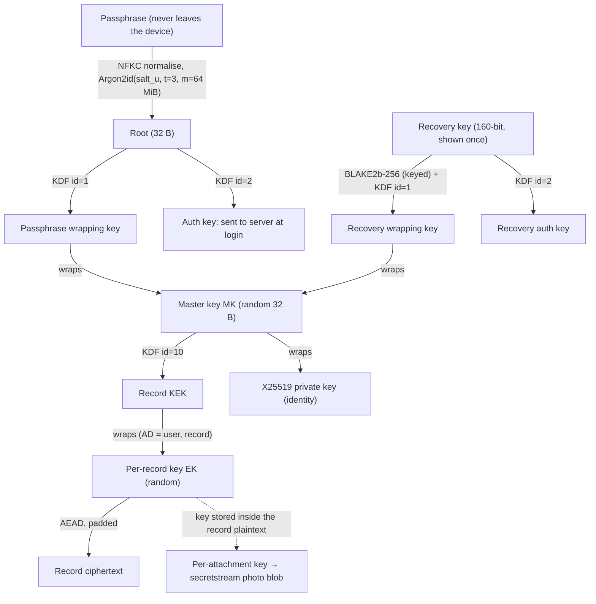
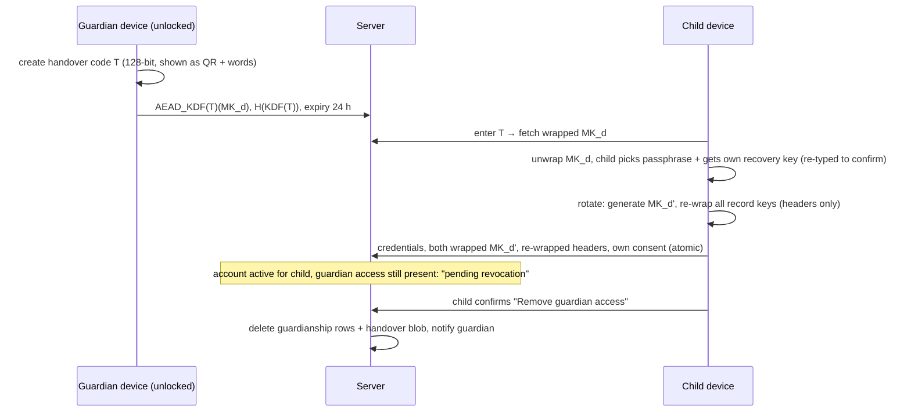

# Architecture

Status: **proposal (M0)**. Nothing here is final until the owner confirms the open decisions at the end of this file.
Spec: [`SPEC.md`](SPEC.md). Threat model: [`THREAT_MODEL.md`](THREAT_MODEL.md).

## 1. Shape of the system

E2EE forces one design choice above all: **the server cannot render or query content.** The server is a
small, untrusted "encrypted blob store with accounts". All product logic (timeline, search, charts, heat
map, PDF, export) runs in the browser after decryption.



The Pi only makes outbound connections (image pulls, optional push, optional ACME DNS challenge).
Nothing is exposed to the internet.

## 2. Stack proposal

I agree with the suggested direction, with a few adjustments flagged in **bold**.

| Concern | Proposal | Why | Alternatives considered |
| --- | --- | --- | --- |
| App framework | SvelteKit 2 + Svelte 5 + TypeScript, `adapter-node`, single process | Smallest client bundles of the mainstream frameworks (matters on phones and for a Pi), file-based routing, API routes and the UI in one process, built-in service worker support with no Workbox needed | **Vite SPA + Hono API**: equally small and avoids SvelteKit's inline bootstrap script (see CSP below), but needs two toolchains glued together. **Next.js/React**: heavier runtime, and RSC/SSR give nothing when the server cannot read content. **SolidStart**: fine, but a smaller ecosystem |
| Rendering mode | **App routes render client-side only (`ssr = false`); only the static shell is prerendered** | The server cannot read content, so SSR has nothing to render. CSR also keeps decrypted data from ever touching server code paths | Full SSR: no benefit, and a bigger attack surface |
| Runtime | **Node 24 LTS** | Supported until April 2028; Node 22 is in maintenance and reaches end of life in April 2027 | Bun/Deno: smaller ecosystem for native SQLite on arm64 |
| Database | SQLite (WAL mode) via better-sqlite3 + Drizzle ORM | Zero extra containers, a single file to back up, fast on SSD, about 10 MB of RAM. Drizzle gives typed queries and SQL migrations without a heavy runtime | **Postgres**: about 100 MB more RAM and another container, with no benefit for 4–50 users. **Node's built-in `node:sqlite`**: promising, but Drizzle support and the online-backup API are less mature; we can revisit later. **Kysely**: good, but Drizzle's migration tooling is simpler |
| Crypto | libsodium-wrappers-sumo (ISC) | One audited library for XChaCha20-Poly1305, Argon2id, BLAKE2b KDF, X25519 sealed boxes and secretstream, using fast WASM. **Only the sumo build contains Argon2id (`crypto_pwhash`)**: verified, the standard build does not | WebCrypto: no XChaCha20 or Argon2. @noble/ciphers + @noble/hashes (MIT, audited): pure-JS Argon2 at 64 MiB is several times slower on iPhones. hash-wasm (MIT) for Argon2 + noble for AEAD: smaller, but two libraries instead of one |
| i18n | **Small in-house typed module** (`src/lib/i18n`, no dependency, D21) | Message keys are TypeScript-checked, the Danish catalogue must contain every English key (compile error otherwise), `Intl` handles numbers and plurals, and `npm run lint` rejects hard-coded text in components | Paraglide JS (MIT): good, but its project loads the message-format plugin **from a CDN (jsdelivr) at build time**, a third-party fetch and supply-chain risk. svelte-i18n (MIT): runtime and larger |
| Styling | Hand-written CSS with design tokens (CSS custom properties) and a small in-house Svelte component library | The spec rules out admin UI kits; tokens make light/dark mode and Dynamic Type straightforward | Tailwind: fine, but tokens + scoped Svelte styles need no extra dependency |
| Icons | Lucide (ISC), only the used SVGs vendored | Friendly rounded strokes; ISC is on the allow-list | Phosphor (MIT): also good, with a warmer duotone style. Could swap |
| Charts | Hand-built SVG charts with d3-scale/d3-shape (ISC) | A few KB. Full control over calm styling, and no "red zone" defaults (MDR) | uPlot (MIT): fast but canvas, so harder to make accessible. Chart.js: about 200 KB |
| PDF | Decide in M5: a print stylesheet (zero dependencies) or pdf-lib (MIT) | A print stylesheet reuses the SVG heat map as-is. pdf-lib is more deterministic on iOS standalone PWAs, but it is a 19 MB package (needs approval) | jsPDF: bundles code under various licences |
| Web Push | **No push library. Payload-less pushes signed with our own VAPID (ES256) via `node:crypto`** | `web-push` is **MPL-2.0, which is not on the allow-list**. A payload-less push needs no payload encryption at all, and it is the most private option: Apple and Google receive nothing but timing. The service worker shows the generic text locally | Implementing RFC 8291 payload encryption ourselves: about 150 lines, but unnecessary |
| Tests | Vitest 5 (unit, including all crypto), Playwright (e2e against the production build, phone viewport; Chromium locally, Chromium + WebKit in CI) | Standard, fast, and MIT/Apache | |
| Licence check | `license-checker-rseidelsohn` (BSD-3) driven by `scripts/check-licenses.mjs`, plus `static/ASSET_LICENSES.json` for assets | Shipped code (production dependencies and the SvelteKit/Svelte runtime bundled into the build) must be MIT/BSD/ISC/Apache-2.0 (CC0/CC-BY for data). Build/test tooling may also be BlueOak-1.0.0 or Python-2.0 (D22). Every static file needs a listed licence | |
| Container | Multi-stage Dockerfile, `node:24-bookworm-slim` runtime, non-root user, read-only root filesystem, `/data` volume | Prebuilt better-sqlite3 binaries exist for glibc arm64/amd64. Slim Debian avoids musl surprises | Alpine: about 40 MB smaller, but native-module risk. Distroless: no shell for `docker exec` maintenance |

**Footprint target:** a compressed image of about 80 MB and an idle RSS of about 70 MB. The Compose
`mem_limit` is 256 MB. Argon2id never runs on the server (see §3), so login cannot spike server memory.

### 2.1 Central branding config

`brand.config.json` (M1) holds `displayName`, `shortName`, `description` and `themeColor`. The PWA
manifest, `<title>`, About page and i18n "app name" variable are generated from it. `package.json` keeps a
neutral `"name": "app", "private": true`. CI derives the Docker image name from `github.repository`, and the
Compose files read the image from an `IMAGE` variable in `.env`. **A rename is one file plus the repo name**
(plus updating `IMAGE` on hosts that are already deployed).

### 2.2 Content Security Policy and the "no inline scripts" rule

SvelteKit's client bootstrap includes one small inline `<script>`. SvelteKit's built-in `kit.csp` in
**hash mode** emits a `sha256-…` hash for it, so the policy never needs `'unsafe-inline'`. This is what Google's
"strict CSP" guidance calls hash-based CSP. Planned header:

```
default-src 'none'; script-src 'self' 'wasm-unsafe-eval' 'sha256-<bootstrap>';
style-src 'self'; style-src-attr 'unsafe-hashes' 'sha256-<announcer style>'; img-src 'self' blob: data:; font-src 'self'; connect-src 'self';
manifest-src 'self'; worker-src 'self'; base-uri 'none'; form-action 'self';
frame-ancestors 'none'; object-src 'none'
```

`'wasm-unsafe-eval'` is **required** for libsodium's WASM. Without it, libsodium silently falls back to
asm.js, and Argon2id becomes unusably slow on phones. Styles are emitted as external CSS files; M1 will verify
with a CSP violation test in e2e that no `'unsafe-inline'` is needed for styles either. Trusted Types are left out
because Svelte builds templates via `innerHTML`. The only inline style is SvelteKit's screen-reader route announcer; its
fixed `style` attribute is allowed by hash alone (`style-src-attr`), and an e2e test fails on any CSP violation, so a framework
update that changes it cannot slip through. If you want literally zero inline script tags, the alternative is the Vite SPA +
Hono stack in the table (decision D2).

## 3. Key hierarchy

All primitives come from libsodium. "AEAD" means XChaCha20-Poly1305-IETF with a random 24-byte nonce.
Every AEAD call binds associated data (AD) to the user and object it belongs to, so a malicious server
cannot swap ciphertexts between records or users without detection.



| Key | Generated | Stored on server as | Purpose |
| --- | --- | --- | --- |
| Root | Argon2id(passphrase, per-user random 16-byte salt). Parameters stored per user and upgradable at login | never | Derives the passphrase wrapping key and the auth key via `crypto_kdf_derive_from_key` (BLAKE2b) with context `MDBkdf01` |
| Passphrase wrapping key (PWK) | KDF(root, 1) | never | Wraps MK |
| Auth key (AK) | KDF(root, 2) | `SHA-256(AK)` (the verifier) | Login proof. Cryptographically independent of PWK, so the server learning AK reveals nothing about PWK |
| Recovery key (RK) | 160 random bits, shown once as 8 groups of 4 Crockford-base32 characters | never | Wraps a second copy of MK |
| Recovery wrapping key (RWK) / recovery auth key (RAK) | KDF(BLAKE2b-256(key="MDB-recovery-key-v1", RK), 1 / 2) | `SHA-256(RAK)` | Recovery login proof + MK unwrap |
| Master key (MK) | random 32 bytes at signup | `AEAD_PWK(MK)` and `AEAD_RWK(MK)`, AD = `mk/v1/<userId>` | Root of everything a user owns |
| Record KEK | KDF(MK, 10), context `MDBkeys1` | never | Wraps per-record keys |
| Identity keypair | X25519 at signup | public key in clear; `AEAD_MK(privateKey)` | Guardianship now; sharing between adults later |
| Per-record key (EK) | random 32 bytes per record | `AEAD_KEK(EK)` with AD = `rec/v1/<userId>/<recordId>`, in a separate column | Encrypts one record. Enables cheap MK rotation (re-wrap 72-byte headers instead of re-encrypting content), per-record shredding and future sharing |
| Attachment key | random per photo | inside the record plaintext only | `crypto_secretstream_xchacha20poly1305` over the photo |

**Why no server pepper on the verifiers:** AK has 256 bits of entropy, so `SHA-256(AK)` cannot be
reversed (the server hashes with `node:crypto`; BLAKE2b keys must be at least 16 bytes, hence the long recovery key label). An attacker holding the database can test passphrase guesses against the wrapped MK anyway (one
Argon2id per guess), so a pepper would add a lockout risk (losing `.env` would lock out every user) without
adding protection.

**Why Argon2id runs only on the client:** the server never receives anything passphrase-equivalent,
and the Pi never spends 64 MiB of RAM per login attempt, which also makes login a poor denial-of-service
target. Parameters (t=3, m=64 MiB, p=1, which matches Bitwarden's Argon2id defaults apart from parallelism) are
calibrated in M2 on a real iPhone. The target is under 1.5 s.

### 3.1 Signup (invite-only)

1. The admin creates an invite. The link carries a random token **in the URL fragment** (`/join#t=…`), so it never
   reaches server logs or Referer headers. The server stores only `SHA-256(token)`, role and expiry (72 h by default).
2. The client generates the salt, MK, identity keypair and RK, and runs Argon2id to derive PWK and AK.
3. Onboarding explains privacy in plain language. It shows the recovery key with save, print and copy
   options. **To confirm, the user re-types two randomly chosen groups**, not just ticks a checkbox. Then the user
   accepts the versioned consent text.
4. The client uploads: username, salt, KDF parameters, `H(AK)`, `H(RAK)`, both wrapped MKs, the public key, the wrapped
   private key, and `{consentVersion, consentTextHash, locale}`. The server timestamps the consent itself.

### 3.2 Login and unlock

1. `POST /api/auth/prelogin {username}` returns the salt and KDF parameters. **For unknown usernames, the server returns
   a deterministic fake salt** (`HMAC(serverSecret, username)`), so the endpoint cannot be used to enumerate accounts.
2. The client derives AK and sends `POST /api/auth/login {username, AK, totp?}`. The server compares hashes in
   constant time and sets the session cookie.
3. The server returns the wrapped MK and wrapped private key. The client unwraps them and holds MK **in memory only**.
4. **Lock vs. logout:** auto-lock (default 5 min of inactivity, or 60 s in the background; decision D9) wipes MK
   and all decrypted state from memory but keeps the session. Unlocking re-runs Argon2id locally against the
   wrapped MK cached in IndexedDB, and needs no server round trip. Logout destroys both the session and the local cache.

   **As built (auth-ui).** The wrapped bundle is cached in memory only (from `/api/auth/session` or login), not in IndexedDB;
   unlock first refreshes it from `/api/auth/session` (picks up a passphrase changed elsewhere, detects a revoked session)
   and falls back to the cached copy when offline. `UnlockedKeys` sit in a plain module variable in `src/lib/session.svelte.ts`,
   never in `$state` or any browser storage, so a reload always starts locked. The root layout gates routes: signed out means
   `/login`, `/join`, `/recover` only; signed in but locked means a full-screen Unlock view replaces the page (same URL, so
   unlocking returns to where you were); tab bar and quick-log exist only while unlocked. Auto-lock (`src/lib/autolock.ts`)
   locks after N minutes (1, 2, 5, 10, 15 or 30; localStorage preference, default 5) without pointer, key, touch or scroll
   events, or 60 s after the page becomes hidden; returning to a long-hidden page re-checks the clock before showing anything.
   `lock()` wipes the keys and runs registered `onLock` hooks for any decrypted caches. A 401 `unauthenticated` from any API
   call drops the UI to signed-out. Recovery tokens last 15 minutes, enough to save and confirm the new recovery key.

Sessions use a 256-bit random token in a `__Host-sid` cookie (`HttpOnly; Secure; SameSite=Strict; Path=/`). The server
stores only its SHA-256 hash, with a 30-day idle expiry. State-changing API calls also require a same-origin
`Origin` header and `Content-Type: application/json`.

### 3.3 Passphrase change and recovery

- **Change passphrase:** new salt, new PWK and AK, MK re-wrapped. Content is not touched. Other sessions are revoked.
- **Recovery:** the user enters RK. The client derives RAK and sends it. The server checks `H(RAK)` and returns `AEAD_RWK(MK)`.
  The user sets a new passphrase. **A new recovery key is then issued and must be confirmed again**, because the old one
  has now been typed on a device.
- **Losing both the passphrase and the recovery key means the data is gone.** This is stated at signup in plain words:
  "Nobody, including the person who runs this server, can get your diary back."

**Implementation notes (auth-server).** All binary values travel as URL-safe base64 without padding. Endpoints (JSON, all
`cache-control: no-store`; errors are `{ "error": "<code>" }`):

| Endpoint | Notes |
| --- | --- |
| `POST /api/auth/prelogin` | salt + KDF parameters; fake salt `HMAC-SHA256(SESSION_SECRET, "prelogin:" + username)[0..16]` with the default parameters for unknown names |
| `POST /api/invites/check`, `POST /api/invites` | token check (404 `invalid_invite`); admin-only creation (default 72 h, role `member` or `admin`), audited |
| `POST /api/auth/signup` | one transaction: consume invite, insert user, consent (server timestamp, actor `self`), `signup` security event; 409 `username_taken` leaves the invite unused |
| `POST /api/auth/login`, `GET /api/auth/session`, `POST /api/auth/logout` | login and session return the wrapped-key bundle (`kdfSalt`, `kdfParams`, `wrappedMkByPassphrase`, `wrappedPrivateKey`, `publicKey`) |
| `POST /api/auth/recover/start`, `POST /api/auth/recover/finish` | start checks `H(RAK)` and issues a 15-minute single-use token (hash in `recovery_tokens`); finish replaces passphrase and recovery secrets, revokes all sessions and signs in |
| `POST /api/auth/passphrase` | needs the current auth key; revokes all other sessions |
| `POST /api/account/delete` | needs the auth key; see §7 |

- **Cookie naming:** `__Host-sid` (`HttpOnly; Secure; SameSite=Strict; Path=/`) by default. With `COOKIE_SECURE=false` (plain-http
  development and the e2e server) the cookie is `sid` without `Secure`, because browsers refuse `__Host-` cookies without `Secure`.
  The expiry slides (30 days idle) and `last_seen_at` is written at most once an hour.
- **Origin guard:** every non-GET request under `/api/` needs `Content-Type: application/json` and an `Origin` equal to the
  request's own origin (`ORIGIN` when set, as adapter-node does); otherwise 403 `bad_origin` / `bad_content_type`.
- **Unknown, wrong and disabled** all return 401 `invalid_credentials`; unknown users get a dummy hash comparison.
- **Environment:** `SESSION_SECRET` (random per process with a logged warning if missing, which only changes fake salts after a
  restart), `COOKIE_SECURE`, `IP_RETENTION_DAYS` (§8), `AUTH_RATE_USER_BURST`, `AUTH_RATE_IP_BURST`, `AUTH_RATE_WINDOW_S` (§8).
- **First admin:** `node scripts/cli.mjs invite --admin` (§10). The invite URL carries the token in the fragment.

### 3.4 Optional TOTP

TOTP protects the *login session* (for example, against someone who has learned the passphrase but not the device). It does
not change encryption and never touches the diary keys. It stays optional, as specified.

**Implemented (feature/totp).** RFC 6238 with SHA-1, 6 digits, 30 s steps, written on `node:crypto` (no dependency); a code is accepted
for the current step and one step either side.

- **Enrolment** (all need a session): `POST /api/auth/totp/setup {authKey}` re-authenticates with the current auth key, creates a 20-byte
  secret and stores it as *pending* (`users.totp_pending_enc`), returning `{ secret, uri }` once (`otpauth://totp/<name>:<user>?secret=...&issuer=<name>&digits=6&period=30`).
  Nothing changes at sign-in yet. `POST /api/auth/totp/enable {code}` checks the code against the pending secret and, if valid, makes it the active
  one (`totp_secret_enc`). `POST /api/auth/totp/disable {authKey, code}` needs the passphrase and a fresh code. `GET /api/auth/totp` returns
  `{ enabled }`. There is no QR code (no library); the screen shows the key in groups of four and an "Open in authenticator app" link that
  hands the otpauth URI to an installed authenticator app.
- **Sign-in:** `POST /api/auth/login {username, authKey, totp?}`. The TOTP state is looked at only AFTER the auth key verified. Without
  `totp` the answer is 401 `totp_required`; with a wrong code, 401 `invalid_totp`. Wrong codes count against the same login limiter as wrong
  passphrases and are recorded as `totp_failed` security events. An unknown user or wrong key always gets the generic 401 `invalid_credentials`,
  so a stranger cannot learn who uses TOTP. The client keeps the derived keys in memory for the code step (no second Argon2id run).
- **Replay protection:** `users.totp_last_step` holds the newest accepted time step. A code whose step is at or below it is refused, and the
  update is conditional (`WHERE totp_last_step IS NULL OR totp_last_step < ?`), so two parallel requests cannot both spend one code.
- **At rest:** the secret is sealed with AES-256-GCM under a key derived from `SESSION_SECRET` with HKDF-SHA-256 (info `totp-v1`), stored as
  nonce (12) | tag (16) | ciphertext. If `SESSION_SECRET` is lost, the secrets no longer open; users then get back in with the recovery key.
- **Recovery bypasses TOTP.** Recovering with the recovery key (§3.3) is the stronger secret, so `recover/finish` signs the user in without a
  code and clears the TOTP secret, pending secret and last step: two-step sign-in is switched off and can be enrolled again. The Me card says so.
- **No backup codes in v1.** The recovery key already covers lock-out (lost phone), and a second set of long-lived codes would be another
  secret to store.

### 3.5 Better than Bitwarden-style? OPAQUE

OPAQUE (an augmented PAKE, RFC 9807) would mean the server never sees AK, even at login, and would remove the salt
oracle entirely. `@serenity-kit/opaque` (MIT, about 0.9 MB) is a credible implementation. **Recommendation: use
derived-key authentication for v1** (simpler, auditable, libsodium-only, adequate on a VPN-only household server),
with a versioned `auth_scheme` column so OPAQUE can be introduced per user at a later login without migrating data
(decision D4).

## 4. Guardians, dependent profiles and handover

**Dependent profile:** a user row with `kind = dependent` and no credentials. Its own MK_d, identity
keypair and records work exactly like an adult's.

- MK_d is wrapped **to each guardian's X25519 public key** (`crypto_box_seal`), one row per guardian in
  `guardianships`. This lets two parents both manage a child without ever knowing each other's keys.
- Guardians recover access to dependents through their *own* recovery key (RK, then MK, then their private key, then MK_d).
- The child's birth month is stored **encrypted** in the dependent's profile record. The client, not the server,
  notices when the configurable age threshold (default 13) is reached and suggests a handover.
- Consent for a dependent is recorded with `actor = guardian:<id>`.

**Handover flow:**



- **Rotation matters:** deleting the guardian's wrapped copy is not enough, because a guardian device could have kept MK_d
  in memory. Rotating to MK_d' is cheap thanks to per-record keys (only 72-byte headers are re-wrapped, no content
  is re-encrypted). After rotation, the guardian cannot read *new* entries even with the old key.
- Honest limit: a guardian could have exported or screenshotted entries while they had access. That cannot be undone and is
  explained in the handover screen.
- **Two different ages (D11):**
  - *Consent age* (configurable, default 13, Denmark's GDPR Art. 8 age): from this age a child can give their own consent.
    It decides who signs the consent record, not who holds the keys.
  - *Handover age* (configurable, default 18): when the app suggests handing the profile over. A guardian can start a
    handover earlier (for example, from the consent age) if the family wants.
- The child confirms the revocation of guardian access; the guardian is notified (D11).

## 5. Data model (server)

The server sees only what it needs to route and authorise. **Everything the user creates is a "record"**,
including settings, tag lists, measurement types and the medication list. So the server cannot even tell
configuration from diary entries.

| Table | Columns (server-visible) |
| --- | --- |
| `users` | id (UUIDv4), username, kind (adult/dependent), role (member/admin), status, created_at, kdf_salt, kdf_params, auth_scheme, auth_verifier, recovery_verifier, wrapped_mk_pw, wrapped_mk_rk, public_key, wrapped_private_key, totp_secret_enc?, totp_pending_enc?, totp_last_step?, storage_bytes |
| `guardianships` | dependent_id, guardian_id, sealed_mk, created_at |
| `records` | id (client-generated UUIDv4), user_id, wrapped_key, ciphertext, size, created_at, updated_at, rev, deleted_at (tombstone, content nulled) |
| `attachments` | id, user_id, size, created_at (the link to a record lives **only inside the encrypted record**) |
| `consents` | user_id, version, text_hash, locale, actor, accepted_at, withdrawn_at |
| `invites`, `sessions`, `handovers`, `recovery_tokens` | hashes of tokens, expiry, minimal metadata |
| `push_subscriptions` | user_id, endpoint, keys, created_at |
| `reminder_slots` | user_id, local time, weekday mask, IANA time zone, enabled. **Not linked to any medication** (see the threat model) |
| `security_events` | type (login_failed, rate_limited, …), user_id?, ip?, at. Pruned after `IP_RETENTION_DAYS` (default 7) |
| `admin_audit` | admin actions (invite, disable, enable, delete); no content |

**Record envelope v1:** `wrapped_key = nonce‖AEAD_KEK(EK)`, `ciphertext = 0x01‖nonce‖AEAD_EK(pad(JSON))`.
Padding uses `sodium_pad` to buckets of 256 B, 512 B, 1 KiB, 2 KiB and 4 KiB, then 4 KiB multiples, so ciphertext size
does not reveal the record type (most records fall into the first two buckets). Photos are padded to 64 KiB multiples.

**Record plaintext (examples):**

```json
{ "v": 1, "type": "food", "at": "2026-10-18T08:10:00+02:00", "meal": "breakfast",
  "text": "Oatmeal with berries", "tags": ["t_home"], "attachments": [{ "id": "…", "key": "…" }] }

{ "v": 1, "type": "pain", "at": "…", "points": [
  { "region": "knee", "side": "right", "space": "2d-front-v1", "u": 0.42, "v": 0.61,
    "intensity": 6, "quality": "aching", "note": "after running" } ] }
```

**Body map, ready for 3D later without migration:** `region` + `side` come from a stable, view-independent
catalogue (for example `knee`, `lower_back`, `temple`; side `left|right|midline`). The catalogue maps each region to its
SVG path and, optionally, an FMA anatomy ID (FMA is CC-BY). Coordinates are region-local `(u, v)` in a **named,
versioned coordinate space** (`2d-front-v1`, `2d-back-v1`, `2d-head-v1`, …). A future 3D view adds a `3d-mesh-v1` space
(for example, barycentric coordinates on a mesh face). Old 2D points still render on the 3D model at their region's
anchor plus a projected (u, v). Nothing is rewritten. Children's profiles use a scaled outline with the **same region IDs and
spaces**, so heat maps stay comparable.

### 5.1 Sync and client storage

- `GET /api/records?since=<cursor>&limit=<n>` returns `{ records, cursor, hasMore }` for the signed-in user: changed records and
  tombstones (null `wrappedKey`/`ciphertext`), ordered by `(updated_at, id)`. The cursor is an opaque base64url of the last
  `(updated_at, id)`; `limit` defaults to 500 (max 1000). `updated_at` is strictly increasing per user (`max(now, last + 1)`),
  so a cursor never skips a change.
- `PUT /api/records/:id` (`{ wrappedKey, ciphertext, baseRev? }`, id a UUIDv4) upserts and returns `{ id, rev, updatedAt }`.
  `wrappedKey` is exactly 72 bytes; `ciphertext` starts with version byte `0x01` and is 297 B to 64 KiB + 41 B (padded
  plaintext 256 B to 64 KiB). A wrong `baseRev` answers `409 { error: "conflict", rev }`. An id owned by another user answers
  `404`, like a missing one. `DELETE /api/records/:id` writes a tombstone (blobs nulled, `rev` + 1). `users.storage_bytes` is
  the sum of blob sizes of live records. The client retries a conflict once on top of the server's version (last writer wins).
- The client keeps **ciphertext** in IndexedDB (database `mydaybook-records-<userId>`: wrapped key, ciphertext, rev, timestamps
  and the sync cursor), so later visits download only changes. The database is deleted on sign-out and account deletion and
  kept on lock. Records that fail to decrypt or validate are skipped and counted, never fatal. Sync runs after unlock and when
  the app becomes visible again (throttled to 15 s). This also prepares for offline-first in a later version.
- Decrypted data lives only in memory (Svelte stores) and is wiped on lock. Nothing decrypted goes to localStorage,
  sessionStorage, IndexedDB, the service worker cache or logs.
- The service worker precaches **all** app chunks at install. Navigating to, say, the body map therefore makes no network request
  that would tell the server which feature is in use.
- Search, filters, charts, the heat map, CSV/JSON export and the PDF are computed client-side from memory.

### 5.2 Photos

**Client pipeline** (`src/lib/photos/process.ts`). A picked file (`<input type="file" accept="image/*">`, which offers camera or
library on a phone) is decoded with `createImageBitmap(file, { imageOrientation: 'from-image' })`, drawn onto a canvas with the longest
side at most 1280 px (aspect kept, never upscaled) and re-encoded as JPEG at quality 0.7. Re-encoding drops all EXIF/GPS metadata.
If the result is over 400 KiB (a very detailed photo), it is re-encoded in steps (quality 0.55, then 1024 px, then 800 px at 0.5)
until it fits. A typical phone photo ends up around 150 KB, because the Pi is a shared machine. JPEG rather than WebP, because
Safari's canvas cannot encode WebP. A thumbnail (longest side 256 px, quality 0.6, about 10 KB) is made the same way and stored as a second attachment, so the timeline never
decrypts a full image. Non-images and inputs over 25 MB are refused with a friendly message. Up to 4 photos per entry.

**Encryption** (`src/lib/crypto/attachments.ts`). Each attachment gets a fresh random 32-byte key and is encrypted with
`crypto_secretstream_xchacha20poly1305` in 64 KiB chunks, the last one tagged FINAL. The plaintext is `u32 length || data ||
zero padding` up to a multiple of 64 KiB, so the blob size only shows a 64 KiB bucket. Blob = 24-byte header + n x (64 KiB + 17).
A wrong key, altered, reordered, truncated or extended stream fails to decrypt.

**Reference.** The key and ids live only inside the encrypted record: `attachments?: { id, key, thumbId, thumbKey, w, h, mime }[]`
on **any** record type (D8), so "has a photo" does not reveal "this is a meal". The server cannot link a blob to a record.

**Endpoints** (`/api/attachments/:id`, id = UUIDv4, owner-scoped; someone else's id is answered like a missing one):

| Method | Behaviour | Status |
| --- | --- | --- |
| `PUT` | raw `application/octet-stream` body, 1 byte to 1.25 MiB; written atomically (temp file + rename) to `<DATA_DIR>/blobs/<userId>/<id>`; inserts or replaces the `attachments` row (`user_id`, `size`, `created_at`) and updates `users.storage_bytes` in an IMMEDIATE transaction | 200, 400 bad id/empty, 401, 403 (guard), 404 foreign id, 413 over 1.25 MiB, 415 JSON content type |
| `GET` | streams the blob to its owner; `cache-control: no-store`, `content-type: application/octet-stream` | 200, 401, 404 |
| `DELETE` | removes file, row and storage accounting | 200, 401, 404 |

**Origin guard change.** The guard (§8) only accepted JSON for state-changing requests. It now also accepts
`application/octet-stream`, **only** for paths under `/api/attachments/`, and the same-Origin requirement is unchanged. Wrapping
a megabyte of ciphertext in JSON/base64 would cost a third more memory and bandwidth on a phone. A cross-site HTML form cannot send that
content type, and a cross-site `fetch` with it needs a CORS preflight that the server never answers, so no CSRF path opens.

**Body limit.** adapter-node rejects bodies over `BODY_SIZE_LIMIT` (default 512 kB) before any route runs, so the deployment must set
`BODY_SIZE_LIMIT=2M` (the e2e server does; the compose file will). The route itself enforces the 1.25 MiB cap and answers 413.
It is a global adapter setting, so JSON endpoints share the 2 MB ceiling; they still validate sizes themselves.

**Deleting.** Deleting a record queues its photos for deletion after a 10 s grace period, longer than the 5 s Undo toast; Undo cancels
the queue entry (the same blobs are still referenced when the record is written back). The queue holds only attachment ids (no keys) in
`localStorage` and is flushed on the next unlock, so a reload inside the window does not leave blobs behind. Removing a photo while
editing an entry deletes it right after the save.

**Display.** Decrypted images exist only as Blob object URLs, revoked when the last view using them goes away and on lock or sign-out.
They are never written to IndexedDB or any cache; the service worker ignores `/api/`. Attachments are not cached at all in v1.

### 5.3 Record types (v1)

Every type below is an encrypted record (§5). The server cannot tell them apart. Owner-approved additions to the spec
(2026-10-18) are marked ★.

| Type | Fields (inside the ciphertext) | Fast path |
| --- | --- | --- |
| `food` | meal type, time, text, tags, `where` (home / out / takeaway) ★, `exposures` ★: one entry per watched item, each `no / unsure / yes`, attachments | **Saved meals** ★ fill in everything with one tap; "Again?" repeats the last meal |
| `sensitivity` ★ | the user's own watch list: label, icon, kind (`intolerance`, `allergen`, `other`) and order. Suggestions cover the 14 EU allergens (Reg. 1169/2011 Annex II: gluten cereals, milk, eggs, nuts, peanuts, soy, fish, crustaceans, molluscs, celery, mustard, sesame, sulphites, lupin), plus lactose, fructose, FODMAP, histamine, sorbitol, caffeine and alcohol | Only watched items appear on the meal sheet, so most people see 2–3 rows |
| `saved_meal` ★ | name, meal type, text, tags, exposures | |
| `feeling` | mood, energy and stress (1–5), symptom tags with severity, note | One tap from Today |
| `sleep` | fell asleep, woke up (both full timestamps, so midnight is handled), quality 1–5, awakenings (0–3+), naps, note | Pre-filled from the user's usual times; "Usual night" one-tap repeat |
| `measurement` | measurement type id, value(s), unit, context chips (morning, before breakfast, …), note | **Weight is a built-in type and its own quick-log tile** ★. The last value is the default, with ±0.1 steppers |
| `measurement_type` | name, unit(s), number of values (e.g. 2 for blood pressure), decimals | |
| `bowel` ★ | time, type 1–7 (Bristol Stool Form Scale, own illustrations and wording), flags (urgent, straining, pain, not finished, blood seen, mucus), note | 2 taps + Save |
| `gut` ★ | time, symptoms (1–2 of `nausea` / `heartburn`, each with intensity 1–5), context flags (vomited, after a meal, lying down, at night; `vomited` only with nausea), note. Records only: a flag never triggers a message or alert (MDR), as for bowel | 2 taps + Save |
| `pain` | points (region, side, space, u, v, intensity, quality, note) | §5 |
| `medication` ★ (recurring) | name, strength + unit, form, **schedule**: `daily`, `weekdays [..]`, `every N days` or `as_needed`; times, each with an amount *as entered by the user*; start date, optional end date (courses); reminders on/off; active/archived | Set up once. Today and Meds then list each due dose automatically |
| `dose` | medication id, the scheduled slot (date + time, or none for as-needed), status `taken / skipped / late`, actual time | **"All taken" per time slot** ★: one tap logs every due dose in that slot. Undo instead of confirm. A medicine not in the list can be logged from the Medicine sheet ("Log another medicine"); it is saved as a "when needed" medication (archived when "Keep in my medicines" is off), so every dose still links to a medication. The time of a taken dose can be set or corrected in the dose sheet; an as-needed dose can be moved to another medicine |
| `note` | free text, tags | |
| `settings`, `tag` | client settings, tag definitions | |

**Recurring medication, how it works:** due doses are *computed on the device* from active `medication` records. Nothing is
stored until the user acts, so changing a schedule never rewrites history. A dose record links to its scheduled slot, so "late"
is just "logged after the slot". The server only knows the union of reminder times (§6). Not a medical device: amounts are copied
from what the user typed, and the app never multiplies, totals, suggests or checks doses. Pill-count and refill tracking is left
out of v1, to stay clearly on the right side of "dose calculation".

**Food sensitivities and MDR:** the app records exposures and shows the user's *own* entries side by side: "after meals with
gluten", listing what was logged in the following 24 h. It never scores, ranks or concludes ("gluten seems to cause…"), because
that would be a diagnostic insight (MDR Rule 11). The same rule applies to bowel entries: "blood seen" is recorded and appears in
the doctor-visit PDF, but it never triggers a message or alert. General, static information ("talk to your doctor about anything
that worries you") lives on the About page, never as a reaction to an entry.

## 6. Medication reminders (Web Push)

- Opt-in per device. The user picks reminder *times* (for example 08:00 and 20:00 on weekdays). The server stores only the times
  and time zone, not which medication they relate to.
- At each slot the server sends a **payload-less** push signed with VAPID. The service worker shows "Time for a check-in" from
  local i18n strings. Opening it unlocks the app, which computes locally what is due.
- Push transits Apple (iOS) or Google/Mozilla (others). On iOS it requires an **installed PWA (Add to Home Screen) on iOS 16.4+**,
  and permission must be requested from a user gesture. This is documented in-app and in `SELF_HOSTING.md`.
- The server never sends pushes based on measurements (MDR).

## 7. Accounts and admin

- The admin is a role on a normal account. Admin screens show: username, status, created date, storage used, last active
  (day only), and invite/disable/enable/delete controls. There is no content, no record counts by type, and no key access. An admin
  **cannot reset a passphrase** (that would require keys). The only remedy for a locked-out user without a recovery key is deletion and
  re-invitation.
- **Implemented (feature/admin-users).** All admin endpoints need the admin role (403 `forbidden` for members, 401 signed out) and every
  write adds an `admin_audit` row (`invite`, `revoke_invite`, `disable`, `enable`, `delete`; written in the same transaction).
  - `GET /api/admin/users` (200): `{ users: [{ id, username, role, kind, status, createdAt, storageBytes, lastActiveDay, totpEnabled }] }`.
    `lastActiveDay` is `YYYY-MM-DD` (UTC) of the newest session activity, or null. No content, keys, verifiers or IPs.
  - `POST /api/admin/users/:id/disable` (200) ends all of that user's sessions; 409 `cannot_disable_self`, 409 `last_admin`, 404.
    `POST /api/admin/users/:id/enable` (200, 404).
  - `POST /api/admin/users/:id/delete {authKey}` (200): the ADMIN re-authenticates with their own auth key (401 `invalid_credentials`);
    same erasure as account deletion (`eraseUser`: D12 409 `last_guardian`, security events and blobs removed, audit row kept);
    409 `cannot_delete_self` (use account deletion), 409 `last_admin`, 404, 400.
  - `GET /api/admin/invites` (200): open invites `{ id, role, createdAt, expiresAt }`, never the token.
    `POST /api/admin/invites/:id/revoke` (200, 404) deletes an unused invite. Creating invites is `POST /api/invites` (token returned once).
  - UI: Me shows an Admin card only for admins; it opens `/me/admin` (people, invites, "Invite someone" with the one-time link).
    Disable/enable use an Undo toast; delete needs a confirmation sheet and the admin's passphrase.
- **Account deletion (Art. 17):** the user re-authenticates, gets an export offered, and confirms. Then, in one transaction, the server deletes
  records, attachment files, wrapped keys, sessions, push subscriptions, reminder slots and guardianships. With `PRAGMA secure_delete=ON`
  plus `VACUUM` and a WAL checkpoint, the freed pages are overwritten. Deleting the wrapped keys is the crypto-shredding step. **Honest
  caveat:** backups made before the deletion still contain the ciphertext *and* the wrapped keys until rotation (still only
  openable with the user's passphrase or recovery key). The privacy notice will say this, with the backup retention period.
- **Implemented (auth-server):** `POST /api/account/delete` verifies the auth key, then in one transaction deletes the user (foreign keys
  cascade to records, sessions, consents, guardianships, push subscriptions, reminder slots, recovery tokens) **and the user's
  `security_events` rows**. `admin_audit` rows are kept for accountability (D23). Afterwards it removes `<DATA_DIR>/blobs/<userId>/`
  and runs `PRAGMA wal_checkpoint(TRUNCATE)`. Deletion is refused with 409 `last_guardian` when the user is the only guardian of a
  dependent (D12). `VACUUM` is left to the maintenance work in the Docker branch.
- **Withdrawing consent** goes through the same flow (export offered, then deletion).
- An adult with dependents can delete their account as long as every dependent still has at least one other guardian. Their
  guardianship rows are simply removed. Deletion is blocked only when it would leave a dependent with no guardian; the user is
  then asked to add another guardian, hand the profile over, or delete it first (D12).

## 8. Server hardening

- Headers: CSP (§2.2), `Strict-Transport-Security: max-age=<HSTS_MAX_AGE>` (no `includeSubDomains`, see §9), `X-Content-Type-Options`,
  `Referrer-Policy: no-referrer`, `Permissions-Policy` (camera only on capture inputs), `Cross-Origin-Opener-Policy: same-origin`,
  `Cross-Origin-Resource-Policy: same-origin`.
- In-memory token-bucket rate limits on prelogin, login, recover, invite check/accept, signup, passphrase change and account deletion
  (handover follows with its own branch), keyed **per IP and per username** (on a VPN, all phones may share one NAT address).
  Defaults: per username `AUTH_RATE_USER_BURST=10` attempts per `AUTH_RATE_WINDOW_S=60` seconds, refilling evenly, plus an exponential
  lock-out (1 s, 2 s, 4 s, … up to 15 min) after 5 consecutive failures; per IP `AUTH_RATE_IP_BURST=30` per window with no lock-out
  (looser, since one NAT address serves several people). Over the limit: 429 with `Retry-After` and a `rate_limited` security event
  (at most one per key per window). State is per process.
- Logs: structured JSON to stdout with method, route template, status, duration and user ID. **No bodies, no IPs on stdout.** IPs appear
  only in `security_events`, which is pruned hourly after `IP_RETENTION_DAYS` (default 7; 0 stores no IPs, events are then still kept 7 days). The reverse proxy's access log
  is turned off in the shipped Caddyfile, because it would otherwise keep IPs outside our retention control.
- No decrypted content can reach the server, so it cannot be logged there. On the client, the logger is a wrapper that drops
  arguments in production builds, and a lint rule forbids `console.*` in app code.

## 9. TLS for a VPN-only home deployment

Service workers, PWA install, Web Push and `crypto.subtle` all need a secure context. Options:

| Option | How | Pros | Cons |
| --- | --- | --- | --- |
| **A. Public domain + Let's Encrypt via DNS-01** (recommended if you own a domain) | Caddy in the stack gets a wildcard certificate `*.home.example.dk` through your DNS provider's API. Pi-hole local DNS maps `daybook.home.example.dk` to the Pi's VPN/LAN IP | Trusted by every device out of the box. No inbound ports (DNS-01 is outbound only). Auto-renewal. Best for iOS push and PWA behaviour | Needs a domain (about 100 DKK/yr) and a DNS API token on the Pi. The hostname appears in Certificate Transparency logs (a wildcard hides the subdomain) |
| **B. Tailscale HTTPS** (if your VPN is Tailscale) | `tailscale cert` or `tailscale serve` gives a Let's Encrypt certificate for `pi.<tailnet>.ts.net` | Zero DNS work, trusted everywhere | Only applies if you use Tailscale. The tailnet name is in CT logs |
| **C. Private CA** (Caddy `tls internal`, or step-ca) | Install the CA's root profile on each iPhone (then enable full trust in Settings → General → About → Certificate Trust Settings) and on each computer | Fully offline, no domain needed | Manual setup per device, repeated for every new device and every future self-hoster user. PWA and push work on iOS with a fully trusted root, but this is the least-tested path |
| D. Self-signed per host | | | Not workable: iOS will not install the PWA or register service workers reliably |

**Chosen (D3): option A, using the reverse proxy you already run.** The Home Assistant stack's Caddy already holds a valid
certificate for `lory-home.duckdns.org`, which resolves to the Pi's LAN IP. Caddy serves the app at
`https://lory-home.duckdns.org:8444` and forwards it to the app on port 8090. Nothing is opened on the router. Remote use goes
through the router VPN (Synology VPN Plus) today, and Tailscale later. The same URL must keep working over Tailscale (Pi as a
subnet router, or DNS pointing there), because a PWA's identity is its origin: changing the URL means reinstalling and logging
in again (no data is lost; the local cache holds only ciphertext). For self-hosters, A/B/C above remain the documented options.

The app container speaks plain HTTP on port 8090, **published on 127.0.0.1 only**, so it is reachable solely through Caddy. As a
second line of defence for other self-hosters, requests that did not come through the trusted proxy get a page pointing to the
HTTPS URL instead of the app. `TRUSTED_PROXY` (comma-separated IPs) names the proxy whose `X-Forwarded-For` is believed: the app uses the socket peer unless the peer is listed, then the last `X-Forwarded-For` entry (`src/lib/server/auth/proxy.ts`; adapter-node's `ADDRESS_HEADER` is deliberately not set). `PUBLIC_URL` is the one documented origin setting; the image entrypoint passes it to adapter-node as `ORIGIN`, and protocol and host come from it, not from forwarded headers. The proxy's access log for this
site is switched off (IP retention, §8).

**HSTS:** it applies to a host name on *every* port, so `HSTS_MAX_AGE` is configurable and never adds `includeSubDomains` or
`preload` (duckdns.org is a shared domain). On the home Pi, every service on that name is HTTPS-only: start at 86400 for the first weeks, then 31536000.
The rest of the home Pi details are in [`HOME_DEPLOYMENT.md`](HOME_DEPLOYMENT.md).

## 10. Build, release and deployment

- **CI on pull requests to develop/main:** lint, typecheck, unit tests, licence check, `npm audit --audit-level=high`, Playwright e2e.
- **On merge to develop:** the same checks, then `docker buildx` for linux/arm64 + linux/amd64, pushed to `ghcr.io/<owner>/<repo>:edge`.
  We use prebuilt better-sqlite3 binaries to avoid slow compilation under QEMU. Native arm64 runners are used if available on your plan.
- **On tag `vX.Y.Z` on main (created by you):** build `:X.Y.Z` + `:latest`, and publish the changelog generated from Conventional Commits
  (git-cliff, MIT/Apache) in the GitHub release.
- **Pull-based deployment:** the Pi pulls from GHCR. The repo is public, so once the GHCR package is set to public, no token is needed.
  - Home Pi convention (from the Home Assistant session): each app is its own Compose project in its own folder (`~/mydaybook/compose.yaml`,
    `name: mydaybook`), with pinned tags, `restart: unless-stopped`, and data in `~/mydaybook/data`. It is deployed over SSH, not
    as part of the Home Assistant stack. The same Compose files also paste into Portainer for other self-hosters.
  - `compose.family.yml` is pinned to `:X.Y.Z` on port 8090. You update by editing the tag.
  - `compose.staging.yml` (optional on the Pi: project `mydaybook-staging`, port 8091, its own data folder, synthetic seed data) is
    pinned to `:edge-<short-sha>`. CI publishes that tag alongside `:edge`, so staging follows the "no floating tags" rule too.
  - The app must survive the Pi restarting at night: migrations are idempotent, startup never waits on the network, and the healthcheck
    reports ready only after migrations.
- **Configuration:** `.env` on the host only (mode 600). `docker run --rm <image> gen-secrets` writes `SESSION_SECRET`, `VAPID_PUBLIC_KEY`
  and `VAPID_PRIVATE_KEY` directly into `.env`, so the values never appear on screen. `SESSION_SECRET` also keys the fake-salt HMAC and
  encrypts TOTP secrets. Losing `.env` costs sessions, TOTP enrolments and push subscriptions, never diary data.
- **Startup migrations:** before applying any pending migration, the server writes
  `/data/backups/pre-migrate-<UTC timestamp>-<from>-<to>.db` using SQLite's online backup API. **If the backup fails, startup aborts**
  with a clear log line. The last 5 pre-migration backups are kept.
- **Nightly backup (D13):** a scheduled job inside the app writes into `/backup`, which is `~/mydaybook/backup` on the Pi:
  - `db/app-YYYY-MM-DDTHHMMSSZ.sqlite` (UTC; a stable name pattern the NAS job relies on): a consistent snapshot via SQLite's online
    backup API. It is written as `<name>.partial`, checked with `PRAGMA integrity_check`, switched to a single-file journal mode and
    only then renamed, so the NAS job never sees a half-written or broken dump (a failed check deletes it and logs `ok:false`).
    The newest `BACKUP_KEEP` (default 3) files that match the exact pattern are kept; other files are never touched.
  - `blobs/`: a mirror of the encrypted photo store. Blobs are immutable and written atomically, so mirroring them after the DB
    snapshot is consistent. New or changed files (size or mtime) are copied via a `.partial` name, files that no longer exist in
    the source are removed, symlinks are never followed.
  - One log line per run, no user data: `{event:"backup", ok, bytes, blobs, ms}` (on failure `ok:false` and an error code).
  - On demand: `docker compose exec app cli backup` (`cli` wraps `node /app/scripts/cli.mjs`) runs the same code once and prints the dump file name. It works
    while the server runs (online backup, `busy_timeout` 5000). Two backups never overlap inside one process.
  - Schedule: daily at `BACKUP_TIME` (default `23:30`, owner decision: the NAS is off during the night) in the container's local time (`TZ`). After every run, and at start, the next
    run is computed from the local wall clock, so DST changes (23 h and 25 h days) still land on the set time, and a missed run is not
    replayed. `BACKUP_TIME=off` disables it (the e2e server does this). Code: `scripts/backup-core.mjs` (shared with the CLI) and
    `src/lib/server/db/backup.ts` (schedule, logging).
  - Settings: `BACKUP_DIR` (default `<DATA_DIR>/../backup`, which is `/backup` for `DATA_DIR=/data`), `BACKUP_TIME`, `BACKUP_KEEP`.
  - First admin: `docker compose exec app cli invite --admin [--hours 72]` prints one line, `<PUBLIC_URL>/join#t=<token>`.
    The CLI opens `<DATA_DIR>/app.db` directly and does not migrate, so the server must have started once. The token is in the URL
    fragment, so it never reaches server logs or Referer headers; only its SHA-256 is stored.
  - The Home Assistant session's script copies that folder to the NAS at 00:00 (it must finish by 01:00, when the NAS may stop) and keeps 14 days (D14). **A deleted account therefore
    persists, still encrypted, for up to about 14 days**, which the privacy notice will state.
- **Backups and restore:** the pre-migration backup (above) protects against a bad upgrade, the nightly backup against everything
  else, and the NAS copy against losing the Pi. To restore (HOME_DEPLOYMENT.md has the exact commands): stop the app, move
  `data/app.db` aside and delete `app.db-wal` and `app.db-shm`, copy the chosen `backup/db/app-<timestamp>.sqlite` to `data/app.db`,
  `rsync -a --delete backup/blobs/ data/blobs/`, pin the image tag to the version that wrote the dump if it is newer than the running
  one, start the app and check `/healthz`. Users get back their passphrase as of the dump date. Restores are manual on purpose.
- **Image (feature/docker):** two stages on `node:24-bookworm-slim` pinned by digest. The build stage runs `npm ci --ignore-scripts`
  (better-sqlite3 13 bundles prebuilt linux x64/arm64 addons, so no compiler is needed), `npm run build`, `npm prune --omit=dev`.
  The runtime stage copies `build/`, production `node_modules`, `package.json`, `drizzle/` and the runtime scripts (`scripts/*.mjs`: CLI, backup core, gen-secrets); runs as 1000:1000 with
  `WORKDIR /app`, `DATA_DIR=/data`, `PORT=8090`, and a node-based `HEALTHCHECK`. It needs only `/data`, `/backup` and a tmpfs `/tmp`
  to be writable. The entrypoint dispatches `gen-secrets` and `cli`, otherwise starts the server. Compose sets `BACKUP_DIR=/backup`
  (also the default for `DATA_DIR=/data`).
- **Implementation notes (server-db):** the schema is `src/lib/server/db/schema.ts`; generated SQL migrations are committed in `drizzle/`
  and applied at startup from `./drizzle` relative to the working directory (override with `MIGRATIONS_DIR`), so the Docker image must
  copy `drizzle/` next to `build/` and run with that working directory. Environment: `DATA_DIR` (default `./data`; holds `app.db`,
  `blobs/`, `backups/`), `BACKUP_DIR`, `BACKUP_TIME`, `BACKUP_KEEP` (see the nightly backup above). Failure of the pre-migration
  backup or of any migration exits the process with code 1. `invites`, `sessions` and `handovers` store SHA-256 token hashes;
  `security_events` and `admin_audit` have no foreign key to `users`, so they outlive an account.
- `GET /healthz` returns `{status:"ok"}` after a cheap DB query (503 `{status:"error"}` if it fails). It requires no auth and reveals no details. It is used by the Compose healthcheck.

## 11. Accessibility, i18n and platform notes

- 375 px first, `viewport-fit=cover`, and `env(safe-area-inset-*)` for the notch and home indicator.
- **Dynamic Type:** the root font is `-apple-system-body` on iOS (falling back to 100%), and all sizes are in `rem`, so the system text size setting scales the UI.
- WCAG 2.2 AA: 4.5:1 text contrast (the palette is checked in `design/`), 44×44 pt targets (24×24 minimum per 2.5.8), visible focus,
  no colour-only meaning (pain intensity always shows a number), and `prefers-reduced-motion`.
- The body map has a searchable list of all regions as an equivalent alternative to tapping the SVG.
- English + Danish from M1 (message keys only). Danish copy gets reviewed in M7.

## 12. Decisions

Status as of 2026-10-18 (owner review of M0). **Approved** = settled; **Tentative** = work proceeds on it but may change;
**Open** = needs an answer; **Deferred** = owner will decide later.

| # | Decision | Status |
| --- | --- | --- |
| D1 | Stack: SvelteKit 2/Svelte 5, Node 24, SQLite + better-sqlite3 + Drizzle, libsodium-sumo | **Approved** |
| D2 | Hash-based strict CSP (one hashed inline bootstrap script, no `unsafe-inline`) plus `'wasm-unsafe-eval'` | **Approved** |
| D3 | TLS via the existing Home Assistant Caddy at `https://lory-home.duckdns.org:8444`; remote access via VPN Plus now, Tailscale later (§9) | **Approved** |
| D4 | Derived-key (Bitwarden-style) auth for v1, OPAQUE possible later | **Approved** |
| D5 | libsodium-wrappers-sumo despite exceeding the 1 MB rule | **Approved** |
| D6 | Allow SIL OFL-1.1 as a licence for font files only (the app licence stays PolyForm Noncommercial). Start with system fonts | **Approved** |
| D7 | Payload-less Web Push with our own VAPID code (no MPL-2.0 `web-push`); verify on a real iPhone in M3 | **Approved** |
| D8 | Photo attachments on any record type | **Approved** |
| D9 | Auto-lock: 5 min inactivity or 60 s in the background, user-adjustable (1 to 30 min) | **Approved** |
| D10 | Recovery key: 160-bit, 8 groups of 4 Crockford base32 characters, printable sheet | **Approved** |
| D11 | Handover suggested at **18** by default (configurable); the child confirms revoking guardian access and the guardian is notified. The GDPR consent threshold (default 13) stays separate, see §4 | **Approved** |
| D12 | An account may be deleted while it has dependents, **unless** that would leave a dependent with no guardian | **Approved** |
| D13 | Nightly backup: in-app job at 23:30 into `~/mydaybook/backup`, newest 3 kept; the Home Assistant script copies it to the NAS at 00:00, done by 01:00 (originally 04:00 / 04:30; moved by the owner, 2026-10-18) (§10) | **Approved** |
| D14 | Retention: 3 local snapshots; 14 days on the NAS (set by the Home Assistant backup script) | **Approved** |
| D15 | Doctor-visit PDF: try a print stylesheet first in M5; fall back to pdf-lib if the installed iPhone app fails | **Approved** (plan) |
| D16 | Design direction "Linen & Clay" (`design/`) | **Approved** |
| D17 | Scope additions ★: food watch list (intolerances and allergens) with saved meals; bowel movements; recurring medication schedules with "All taken"; dedicated sleep and weight logging (§5.3) | **Approved** (owner request) |
| D18 | Food and symptom views stay descriptive: side-by-side entries, no correlation scores or conclusions; no alerts on bowel entries (MDR) | **Approved** |
| D19 | No BMI, target weights or reference ranges anywhere; weight is shown as plain numbers and change over time | **Approved** |
| D20 | Pill counts and refill reminders left out of v1 | **Approved** |
| D21 | Replace Paraglide with a small in-house typed i18n module (Paraglide fetches a plugin from a CDN at build time) | **Approved** |
| D22 | Licence policy: strict for shipped code; build/test tooling may also be BlueOak-1.0.0 (glob/minimatch family) or Python-2.0 (ESLint's argparse) | **Approved** |
| D23 | On account deletion the user's `security_events` are deleted; `admin_audit` rows are kept for accountability | **Approved** |
